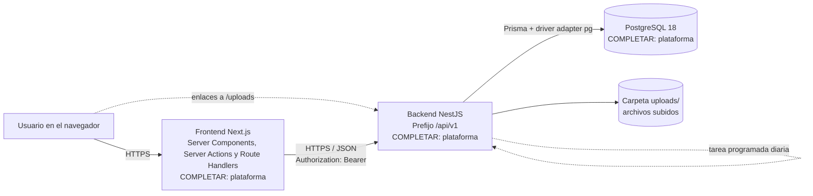

# Arquitectura

## Vista general

El frontend es una aplicación Next.js que actúa como intermediario (BFF) entre el navegador y la API. El navegador nunca recibe el token: la sesión vive en una cookie `httpOnly` y es el servidor de Next.js quien llama a la API de NestJS con ese token. Solo los archivos subidos (`/uploads`: fotos de incidencias y adjuntos de comunicados) se enlazan directamente al backend.



La tarea programada genera las cuotas de las reglas activas todos los días a las 00:05 (hora de `APP_TIMEZONE`).

## Stack

| Capa | Tecnología | Versión |
|---|---|---|
| Frontend | Next.js (App Router), React, TypeScript | Next 16.3, React 19.2, TypeScript 5 |
| Frontend (UI y formularios) | Tailwind CSS, lucide-react, react-hook-form, Zod | Tailwind 4, react-hook-form 7.91, Zod 4.6 |
| Backend | NestJS, TypeScript (ESM), Prisma ORM | NestJS 12, TypeScript 6, Prisma 7.10 |
| Backend (seguridad y utilidades) | @nestjs/jwt, bcrypt, class-validator, @nestjs/throttler, @nestjs/swagger, @nestjs/schedule, pdfkit, multer | según `package.json` |
| Base de datos | PostgreSQL | 18 |
| Pruebas | Vitest (unitarias y e2e), Supertest | Vitest 4 |
| Calidad de código | ESLint (frontend), oxlint y Prettier (backend) | ESLint 9, oxlint 1.58 |
| Contenedores | Docker y docker-compose, imágenes `node:24-alpine` | COMPLETAR: versión de Docker usada |

## Estructura de carpetas

### Backend (`be_boilerplate_is_2026`)

```
.
├── docker-compose.yml        # PostgreSQL 18 + API
├── Dockerfile                # Imagen multi-stage de la API
├── prisma/
│   ├── schema.prisma         # Modelo de datos
│   ├── migrations/           # Migraciones versionadas
│   └── seed.ts               # Datos semilla (roles, usuarios y datos demo)
├── test/                     # Pruebas e2e (*.e2e-spec.ts)
└── src/
    ├── main.ts               # Prefijo /api/v1, validación, Swagger en /api/docs
    ├── app.module.ts         # Módulo raíz y guards globales
    ├── auth/  users/  unidades/        # Sesión, cuentas y unidades
    ├── incidencias/  visitas/  paquetes/  # Operación diaria
    ├── common-areas/  reservas/         # Áreas comunes y reservas
    ├── cuotas/  pagos/                  # Reglas de cuota, pagos y morosidad
    ├── asambleas/  anuncio/             # Asambleas, votaciones y comunicados
    ├── notificaciones/  directorio/  reportes/
    ├── common/  config/  prisma/  health/
    └── generated/prisma/     # Cliente de Prisma (no se versiona)
```

Cada módulo se organiza en capas: `controllers/` → `services/` → `repositories/` (único lugar que usa Prisma), más `dto/` y `errors/`.

### Frontend (`fe_boilerplate_is_2026`)

```
.
├── proxy.ts                  # Protege las páginas: sesión y rol (reemplaza a middleware.ts)
├── Dockerfile                # Salida standalone de Next.js
├── app/
│   ├── login/                # Inicio de sesión
│   ├── (dashboard)/          # Páginas para residente, seguridad y administrador
│   ├── (residente)/          # Notificaciones y preferencias
│   ├── actions/              # Server Actions (mutaciones)
│   ├── api/                  # Route Handlers que reenvían al backend
│   └── components/           # Componentes por funcionalidad
├── components/               # Componentes compartidos (notificaciones, preferencias)
└── lib/                      # Tipos, formateadores y llamadas al backend (*-api.ts)
```

## Decisiones técnicas

| Decisión | Alternativas consideradas | Motivo |
|---|---|---|
| Frontend con Next.js que llama a la API desde el servidor (BFF) | SPA React que llama a la API desde el navegador | El token queda en una cookie `httpOnly` y nunca llega al JavaScript del navegador; además se evita configurar CORS para cada llamada. |
| Sesión con access token JWT (15 min) y refresh token con rotación | Sesiones en servidor, JWT largo sin renovación | El access token es sin estado y de vida corta; el refresh token se guarda con hash SHA-256 y, si se reutiliza uno ya canjeado, se revocan todas las sesiones del usuario. |
| Autorización por rol en dos niveles: `proxy.ts` y `@Roles` en el backend | Validar solo en el frontend | El frontend oculta lo que el rol no puede usar, pero el backend es quien autoriza de verdad (responde `403 ROL_NO_PERMITIDO`). Las rutas no listadas quedan cerradas por defecto. |
| Solo tres roles: Administrador, Residente y Seguridad | Un rol de Mantenimiento independiente | El rol de mantenimiento se retiró en una migración (`quitar_rol_mantenimiento`): las incidencias las asigna y resuelve el administrador. COMPLETAR: confirmar el motivo con el equipo. |
| Arquitectura por capas con repositorios (controlador, servicio, repositorio) | Servicios que usan Prisma directamente | Un solo lugar de acceso a datos por tabla, servicios que se prueban sin base de datos y errores de dominio que no filtran detalles del ORM. |
| Prisma 7 con migraciones versionadas y seed idempotente | SQL manual, otro ORM | Historial reproducible del esquema y los mismos datos de prueba en local y en el ambiente desplegado. |
| Evitar traslapes de reservas con una restricción de exclusión en PostgreSQL | Validar solo en el código | La base garantiza que dos reservas del mismo área no se crucen, incluso con peticiones simultáneas (responde `409 RESERVA_CRUZADA`). |
| Saldos de cuotas calculados, no almacenados | Guardar el saldo en cada cuota | El saldo siempre sale de los pagos aplicados, así no puede desincronizarse. El pago se registra en una transacción con bloqueo de filas. |
| Generación de cuotas idempotente, en lotes y con tarea diaria | Generación solo manual | Ejecutar dos veces el mismo periodo no duplica cuotas, y un fallo en una unidad no detiene las demás. |
| Pasarela de pago simulada en el backend | Integrar una pasarela real | El proyecto es académico: solo se envían los últimos 4 dígitos de la tarjeta y la pasarela simulada acepta o rechaza según la terminación. |
| Validación estricta de entradas (`whitelist` y `forbidNonWhitelisted`) | Ignorar campos de más | Se rechazan datos inesperados con 400 en lugar de descartarlos en silencio. |
| Límite de peticiones por IP (Throttler) | Sin límite | Protege el inicio de sesión y la API de abusos; en pruebas e2e se desactiva. |
| Docker multi-stage para ambos proyectos | Despliegue sin contenedores | Imágenes pequeñas y el mismo entorno en local y en producción. La API aplica las migraciones al arrancar (`prisma migrate deploy`). |
| COMPLETAR: decisión de plataformas de despliegue | COMPLETAR | COMPLETAR |
