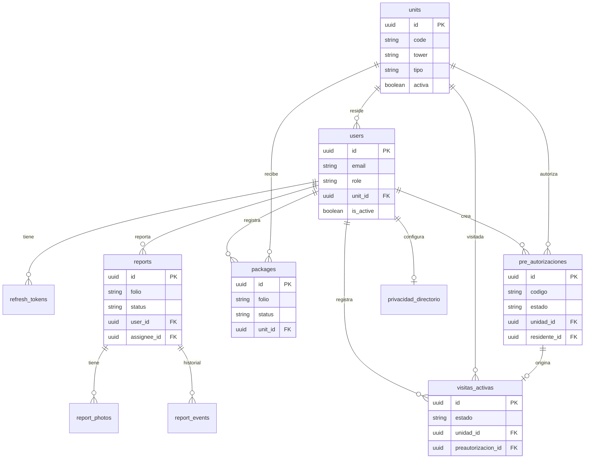
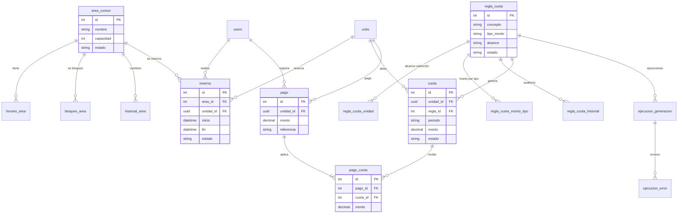
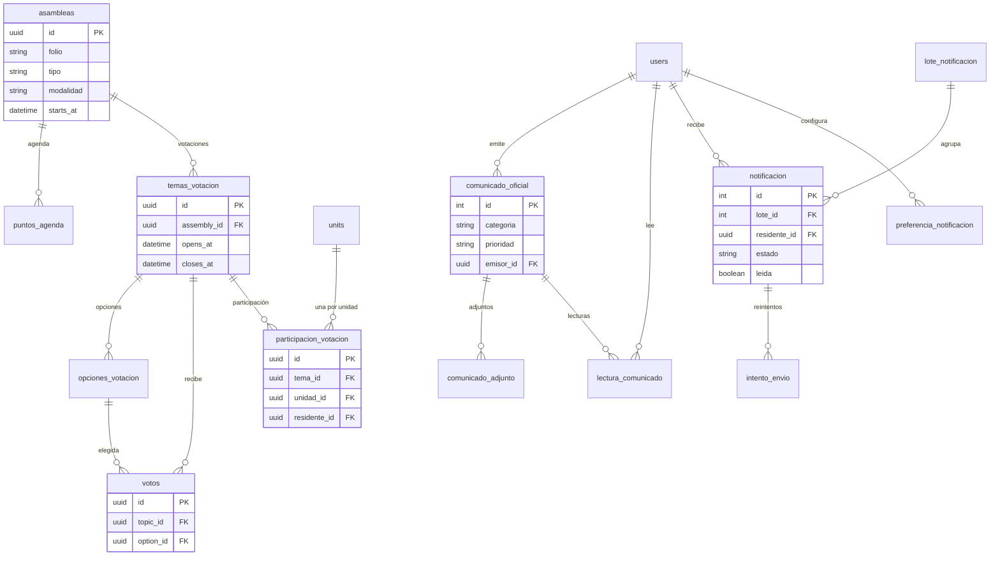

# Modelo de datos

La base es PostgreSQL 18 y el esquema se define en `prisma/schema.prisma`. Los nombres de tabla de abajo son los reales en la base de datos.

## Diagrama entidad-relación

Se divide en tres diagramas por legibilidad. Las tablas `users` y `units` aparecen en todos porque conectan los módulos.

### Cuentas, unidades, incidencias, visitas y paquetes

### Áreas comunes, reservas, cuotas y pagos

### Asambleas, comunicados y notificaciones

> El voto (`votos`) no guarda quién lo emitió: la tabla `participacion_votacion` solo registra que la unidad ya votó. Esto separa el voto secreto del control de una participación por unidad.

## Tablas

| Tabla | Descripción | Campos importantes |
|---|---|---|
| `users` | Cuentas del sistema. Rol: `ADMINISTRADOR`, `RESIDENTE` o `SEGURIDAD`. | `email` (único), `password_hash`, `role`, `unit_id` (solo residentes), `is_active` |
| `refresh_tokens` | Refresh tokens emitidos, guardados con hash. | `token_hash`, `user_id`, `expires_at`, `revoked_at` |
| `units` | Unidades del condominio. | `code` (único), `tower`, `tipo` (`DEPARTAMENTO`, `CASA`, `LOCAL`), `activa`, `historial_desde` |
| `reports` | Incidencias reportadas por residentes. | `folio`, `title`, `category`, `location`, `status`, `priority`, `assignee_id`, `due_date`, `resolved_at`, `resolution_comment` |
| `report_photos` | Fotos adjuntas a una incidencia. | `report_id`, `url` |
| `report_events` | Historial (línea de tiempo) de una incidencia. | `report_id`, `action`, `metadata`, `user_id` |
| `packages` | Paquetes recibidos en la entrada. | `folio`, `unit_id`, `carrier`, `pickup_code`, `status` (`PENDIENTE_RETIRO`, `ENTREGADO`), `received_by_id`, `delivered_by_id` |
| `pre_autorizaciones` | Visitas autorizadas de antemano por un residente. | `codigo` (único), `nombre_visitante`, `documento`, `inicio`, `fin`, `estado` (`VIGENTE`, `USADA`, `CANCELADA`, `EXPIRADA`) |
| `visitas_activas` | Entradas y salidas de visitantes registradas por seguridad. | `estado` (`DENTRO`, `DENTRO_SIN_AUTORIZACION`, `SALIO`), `entrada`, `salida`, `unidad_id`, `preautorizacion_id` |
| `area_comun` | Áreas comunes reservables, con eliminación lógica. | `nombre`, `capacidad`, `ubicacion`, `duracion_bloque_horas`, `estado` (`ACTIVA`, `ELIMINADA`) |
| `horario_area` | Horario de apertura por día de la semana. | `area_id`, `dia_semana`, `hora_apertura`, `hora_cierre` |
| `bloqueo_area` | Periodos en que un área no se puede reservar. | `area_id`, `inicio`, `fin`, `motivo` (`MANTENIMIENTO`, `RENOVACION`, `OTRO`) |
| `historial_area` | Auditoría de cambios de capacidad, horarios y duración de bloque. | `area_id`, `campo`, `valor_anterior`, `valor_nuevo`, `usuario_id` |
| `reserva` | Reservas de áreas por unidad. | `area_id`, `unidad_id`, `residente_id`, `inicio`, `fin`, `estado` (`PENDIENTE`, `CONFIRMADA`, `CANCELADA`); restricción de exclusión que impide traslapes |
| `regla_cuota` | Reglas para generar cuotas (monto fijo o por tipo de unidad). | `concepto`, `tipo_monto`, `dia_generacion`, `dia_vencimiento`, `alcance`, `politica_inactivas`, `estado` (`ACTIVA`, `PAUSADA`, `INACTIVA`) |
| `regla_cuota_unidad` | Unidades de una regla con alcance por selección. | `regla_id`, `unidad_id` |
| `regla_cuota_monto_tipo` | Monto por tipo de unidad de una regla. | `regla_id`, `tipo_unidad`, `monto` |
| `regla_cuota_historial` | Auditoría de reglas: creación, ediciones y cambios de estado. | `regla_id`, `accion`, `valor_anterior`, `valor_nuevo`, `usuario_id` |
| `ejecucion_generacion` | Cada corrida de generación de cuotas, automática o manual. | `regla_id`, `periodo`, `origen`, `creadas`, `omitidas`, `con_error`, `estado` (`EN_CURSO`, `COMPLETADA`, `CON_ERRORES`) |
| `ejecucion_error` | Unidades para las que no se generó la cuota y la causa. | `ejecucion_id`, `unidad_id`, `causa` |
| `cuota` | Cuotas de cada unidad. El saldo no se guarda: se calcula con los pagos. | `unidad_id`, `regla_id`, `concepto`, `periodo` (`AAAA-MM`), `monto`, `fecha_vencimiento`, `estado` (`PENDIENTE`, `PARCIAL`, `PAGADA`, `ANULADA`); único por `(unidad_id, regla_id, periodo)` |
| `pago` | Un pago, que puede cubrir varias cuotas. | `unidad_id`, `usuario_id`, `monto`, `fecha_pago`, `referencia` (única, evita el doble cobro) |
| `pago_cuota` | Cuánto de cada pago se aplicó a cada cuota. | `pago_id`, `cuota_id`, `monto` |
| `asambleas` | Convocatorias a asambleas. | `folio`, `title`, `type` (`ORDINARIA`, `EXTRAORDINARIA`), `modality`, `starts_at`, `ends_at`, `published_at` |
| `puntos_agenda` | Puntos de la agenda de una asamblea. | `assembly_id`, `title`, `position` |
| `temas_votacion` | Temas sometidos a votación dentro de una asamblea. | `assembly_id`, `opens_at`, `closes_at`, `position` |
| `opciones_votacion` | Opciones de cada tema. | `topic_id`, `text`, `position` |
| `participacion_votacion` | Registro de que una unidad ya votó un tema (una participación por unidad). | `tema_id`, `unidad_id`, `residente_id`, `fecha` |
| `votos` | Votos emitidos, sin identificar a quien votó. | `topic_id`, `option_id` |
| `comunicado_oficial` | Comunicados de la cartelera. | `titulo`, `cuerpo`, `categoria`, `prioridad` (`INFORMATIVO`, `IMPORTANTE`, `URGENTE`), `audiencia_tipo`, `emisor_id` |
| `comunicado_adjunto` | Archivos adjuntos a un comunicado. | `comunicado_id`, `ruta_archivo`, `tipo_mime`, `tamano_bytes` |
| `lectura_comunicado` | Lectura de un comunicado por un residente. | `comunicado_id`, `residente_id`, `fecha_lectura` |
| `lote_notificacion` | Lote que agrupa notificaciones emitidas juntas. | `modulo_origen`, `emitido_por`, `fecha_creacion` |
| `notificacion` | Notificaciones por residente. | `residente_id`, `tipo`, `titulo`, `modulo_origen`, `enlace_accion`, `leida`, `estado` (`PENDIENTE`, `ENVIADA`, `FALLIDO`, `FALLIDO_PERMANENTE`) |
| `intento_envio` | Reintentos de envío de una notificación. | `notificacion_id`, `numero_intento`, `motivo_fallo` |
| `preferencia_notificacion` | Qué módulos notifican a cada residente. | `residente_id`, `modulo_origen`, `activo` |
| `privacidad_directorio` | Perfil y privacidad de cada vecino en el directorio. | `user_id`, `nombre`, `apellido`, `telefono`, `visible_global`, `mostrar_*` |

Además hay dos vistas de PostgreSQL usadas por los reportes: `vw_incidencias_abiertas` y `vw_participacion_votaciones`. La extensión `btree_gist` es necesaria para la restricción de exclusión de `reserva`.
